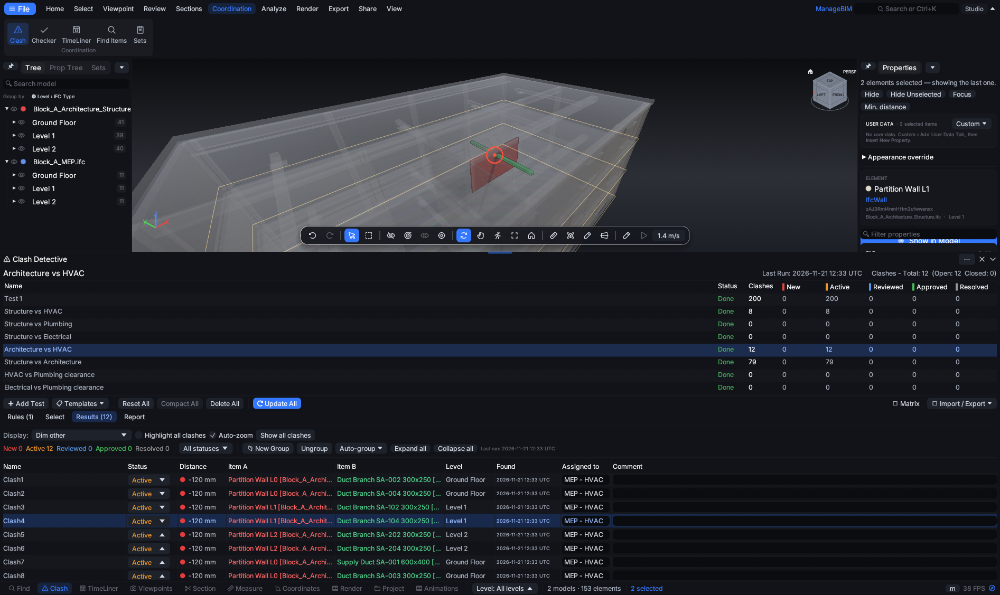
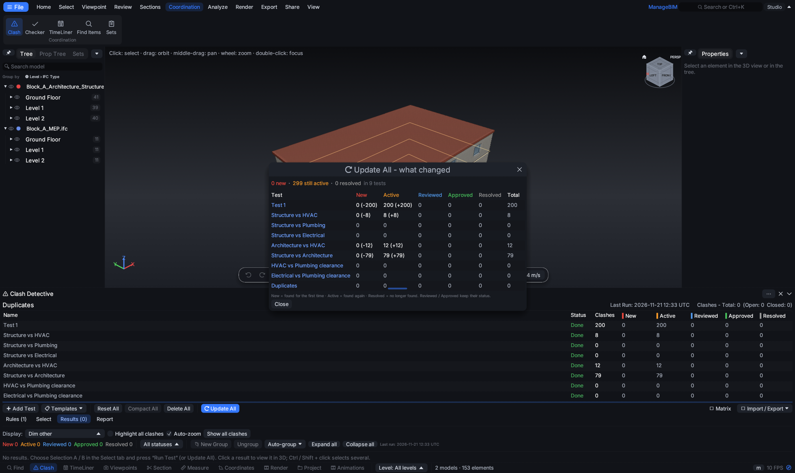
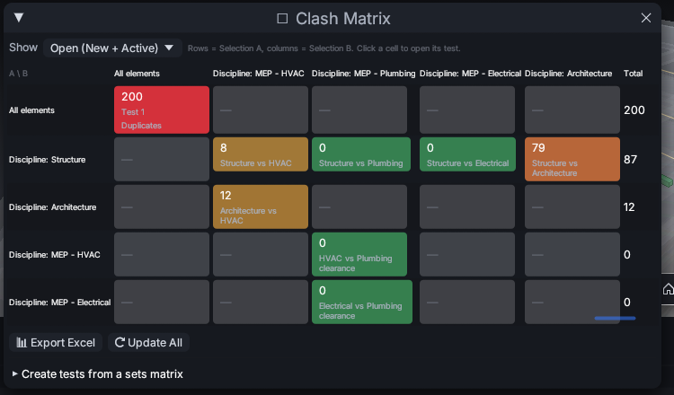
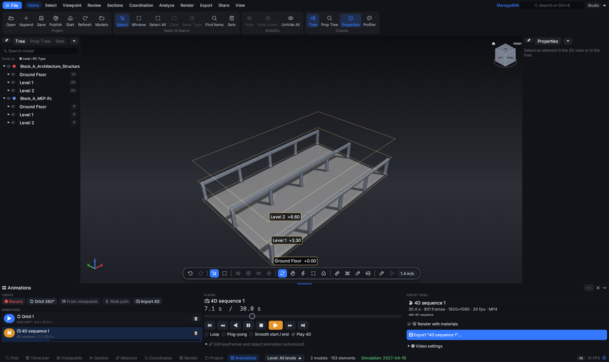
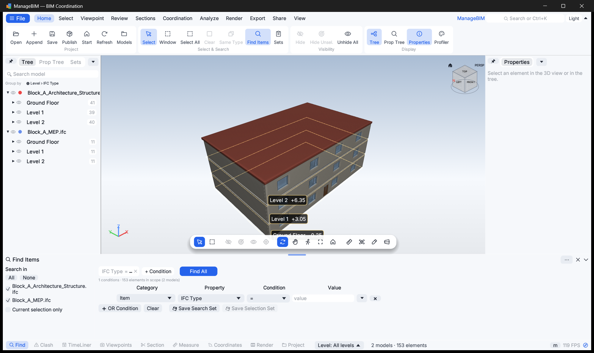
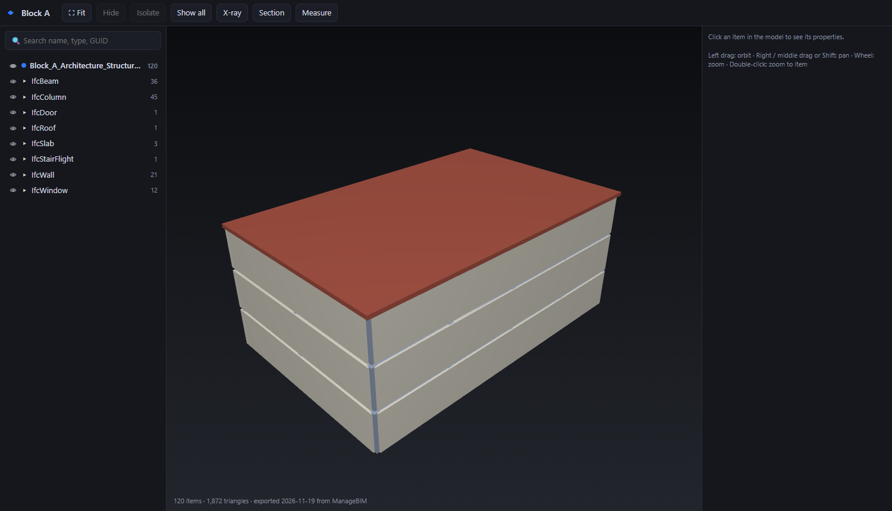
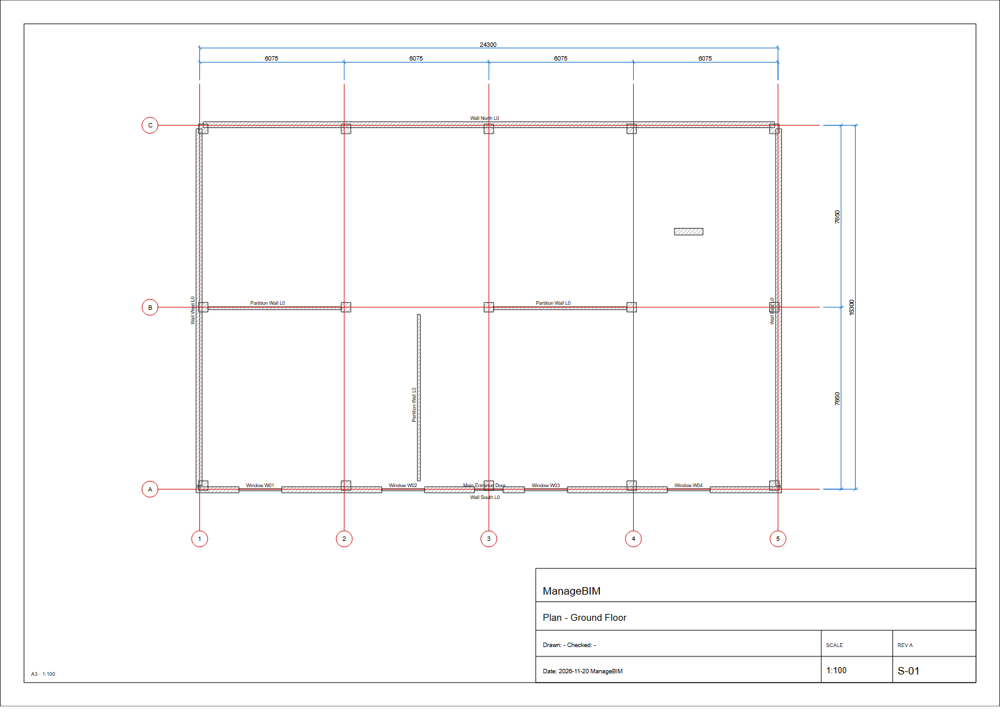
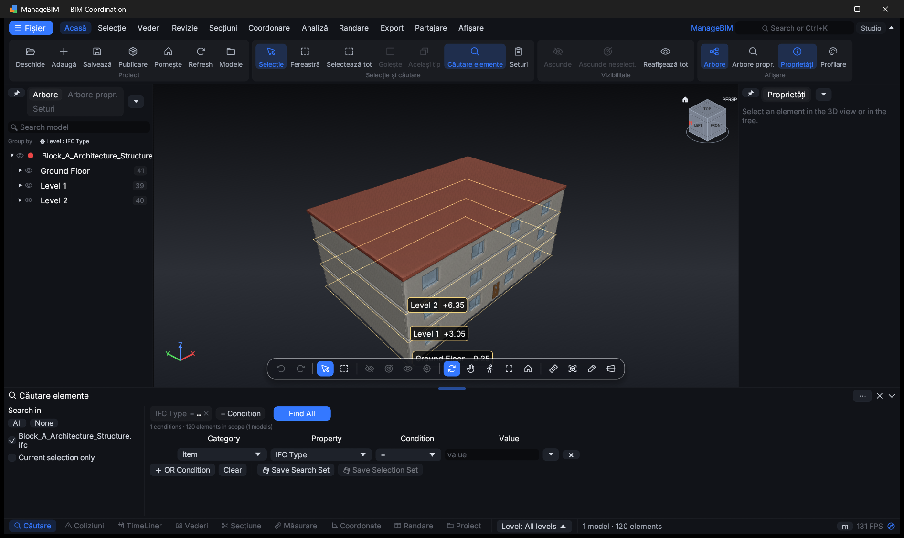

<div align="center">


# ManageBIM

### Federated BIM review & coordination — fast, light, free

Open **IFC, Revit, Navisworks, AutoCAD / Plant 3D, STEP and point clouds** together, run clash detection and model checks,<br>
manage issues and markups, publish drawings — and stay in sync with Revit and Navisworks.

[](https://github.com/Latinu2020/ManageBIM/releases/download/v0.27.1/ManageBIM-Setup-0.27.1.exe)
&nbsp;
[](https://github.com/Latinu2020/ManageBIM/releases)

[](https://github.com/Latinu2020/ManageBIM/actions/workflows/build.yml)


</div>

---

## Why ManageBIM

| | |
|---|---|
| ⚡ **Fast and light** | Native Rust + OpenGL. Opens large federated models in seconds; adaptive level of detail keeps navigation fluid. |
| 🔗 **Works with your tools** | Add-ins for **Revit**, **Navisworks** and **AutoCAD / Plant 3D**: send models, bring issues back, sync the selection live, load ManageBIM models as references. |
| 🧭 **Familiar** | Ribbon, Selection Tree, Find Items, Clash Detective, TimeLiner, viewpoints — the workflow you know from Navisworks. |
| 📐 **Open standards** | IFC 2x3 / IFC4 in and out, **BCF 2.1 / 3.0**, **buildingSMART IDS 1.0**, DWG / DXF, E57 / LAS, glTF. |
| 🆓 **Free and open** | MIT licence, no account, no subscription, no administrator rights to install. |

---

## Screenshots

<table>
<tr>
<td width="50%"><br><sub><b>Clash Detective like Navisworks</b> — tests with New / Active / Reviewed / Approved / Resolved columns, Add Test, Reset / Compact / Delete All, <b>Update All</b>; the clash is shown in the model and the elements' properties next to it.</sub></td>
<td width="50%"><br><sub><b>Update All</b> runs every test again and shows what changed: new, still active and resolved clashes per test.</sub></td>
</tr>
<tr>
<td width="50%"><br><sub><b>Clash matrix by test</b> — Selection A on the rows, Selection B on the columns, the tests and their statuses in each cell; Excel export with a sheet per status. Tests are created from a <b>sets matrix</b> and imported / exported as <b>Navisworks XML</b> or CSV.</sub></td>
<td width="50%"><br><sub><b>Animations</b> in their own window — Record, Orbit 360°, viewpoints, walk path and <b>Import 4D</b>; ▶ Play on each one, then <b>export the video</b>, optionally rendered with materials.</sub></td>
</tr>
<tr>
<td width="50%"><br><sub><b>Five themes</b> — Studio, Dark, Light, Tokyo Night, Nord. Card ribbon in three sizes, vector icons, panels that slide up from the status bar.</sub></td>
<td width="50%"><br><sub><b>Visual styles</b> — Realistic (materials, textures), Shaded, Concept (white study model with edges) and Wireframe.</sub></td>
</tr>
<tr>
<td width="50%"><br><sub><b>PDF sheets</b> from viewpoints — A3 to A0, with an editable title block. Section cuts go to <b>DWG</b> the same way.</sub></td>
<td width="50%"><br><sub><b>Web viewer</b> — the model in a single .html file: tree, search, properties, section, measure. Opens offline in any browser.</sub></td>
</tr>
<tr>
<td width="50%"><br><sub><b>Start page</b> with recent projects, a demo project and the integrated manual.</sub></td>
<td width="50%"><br><sub><b>Point clouds</b> (E57, LAS) next to the model, with the <b>as-built check</b>: built, partial, missing.</sub></td>
</tr>
<tr>
<td width="50%"><br><sub><b>Complete 2D plans</b> from a section — hatched cut walls and columns, door / window and wall tags, grid bubbles and dimension chains, on a sheet with the title block (DWG).</sub></td>
<td width="50%"><br><sub><b>English / Română</b> — the interface language switches from View › Language, the File menu or Ctrl+K.</sub></td>
</tr>
</table>

---

## Download

| Platform | Package | Notes |
|---|---|---|
| **Windows 10 / 11** (x64) | [**ManageBIM-Setup-0.27.1.exe**](https://github.com/Latinu2020/ManageBIM/releases/download/v0.27.1/ManageBIM-Setup-0.27.1.exe) | Wizard installer with the Revit, Navisworks and AutoCAD / Plant 3D add-ins and the OpenCascade runtime. Per-user, **no administrator rights**. |
| **Linux** (x86-64) | `ManageBIM-<version>-x86_64.AppImage` on [Releases](https://github.com/Latinu2020/ManageBIM/releases) | One file: `chmod +x`, then run. No installation, no root. |
| **FreeBSD** (x86-64) | `ManageBIM-<version>-freebsd-x86_64.tar.gz` on [Releases](https://github.com/Latinu2020/ManageBIM/releases) | Unpack and run `ManageBIM/ManageBIM`. Needs `pkg install mesa-libs libxkbcommon`. |

> **0.27.1 (hotfix)** — dedicated **⚙ Settings window** (fonts / DPI 75–200%, themes, export, navigation), a new **Script** ribbon tab with a console for future `.rhai` scripts, **resizable columns + right-click › Rename** in the Clash and TimeLiner tables, **DWG / DXF / PDF sections from Front / Back / Left / Right** with an exact cut position, optional annotations and vector PDF sheets, subtle borders on panels and windows, and a fixed **Path trace Start** button. The Windows installer includes OpenCascade and all three add-ins.
>
> **0.27.0** — progressive CPU path tracing, Navisworks-style clash workflow, Hidden line, uniform ribbon buttons and a full-height Properties panel with all element properties.
>
> **Windows:** the installer is not digitally signed yet — if SmartScreen asks, choose *More info › Run anyway*.
> Silent install: `ManageBIM-Setup-0.27.1.exe /S` (add `/NoAddins` for the application only).
>
> **Linux / FreeBSD:** the add-ins (Revit, Navisworks, AutoCAD) and the native STEP / IGES reader exist only on Windows; everything else is the same.

New here? Open **Help › Demo** for a sample project (architecture, structure, MEP and a 4D schedule), press **Ctrl+K** for the command palette, or read **Help › Manual**.

---

## Features

<details open>
<summary><b>Model review</b></summary>

- **Federated models** — IFC 2x3 / IFC4 (`.ifczip` too) with openings cut, systems, classifications and georeference, Revit and Navisworks (through the add-ins), AutoCAD / Plant 3D DWG with Plant 3D properties, DXF, STEP / IGES / BREP / FCStd, FBX, glTF / GLB, OBJ, STL, PLY.
- **Point clouds** — E57 and LAS, density and point size control, one item per scan.
- **Selection Tree** (group by any property, category colours, counts), **Property Tree**, **Find Items** with condition chips, selection and search **sets**, **Select Same Type / Category**.
- **Navigation** like Navisworks — orbit, pan, walk with gravity and collision, ViewCube, walk paths, viewpoints, animations; adaptive LOD on large models.
- **Visual styles** — Realistic, Shaded, Concept, Wireframe and **Hidden line**; fine edges, soft contact shadows, **sun shadows by date, time and location**, PBR material library (`.zip` packs from freepbr.com, ambientCG…).
- **Command palette** (Ctrl+K) — every command and every element name, in one search box.
- **Arrangeable panels** — dock left / right / bottom or float, auto-hide, and a **Blender-style Properties bar**: add any panel as a tab there; **Model focus** hides the ribbon and panels but keeps Properties floating. UI settings (clash filter, groups, visual style, 4D) are saved between sessions.
- **Interface in English or Romanian** (View › Language).
- **Undo / Redo** of the view (Ctrl+Z / Ctrl+Y) and **DWG / DXF overlay**: lay a 2D drawing over the model at a level.
</details>

<details open>
<summary><b>Coordination</b></summary>

- **Clash Detective** like Navisworks — test list with New / Active / Reviewed / Approved / Resolved columns and test status (New / Done / Old), **Add Test, Reset All, Compact All, Delete All, Update All** (with a summary of what changed), Rules / Select / Results / Report tabs; hard and clearance tests with **severity levels** (Critical / Major / Minor) and **ready-made templates** by discipline, **smart rules** (normal connections ignored, responsible discipline assigned automatically, grouping by system), grouping by level / grid location / type / model / assignee / status; **Filter by Selection** (inclusive / exclusive); Approved / Resolved keep **who and when**; **SwitchBack** sends a clash to Revit / Navisworks with the camera and the two elements; **Scan vs Model** turns as-built discrepancies into clashes; **import / export of clash tests** as Navisworks XML (with the selection sets) or CSV / Excel; **clash matrix by test** (Selection A × Selection B, a sheet per status) and tests created from a **sets matrix**; HTML, CSV, BCF and Navisworks reports.
- **Model Checker** — rules or **buildingSMART IDS 1.0** files (import **and export**): properties, attributes, classifications, materials; exact values, lists, patterns, ranges, optional / prohibited, **unique values** (duplicate marks, GUIDs). Excel and BCF reports. **Quick checks without IDS**: no level, name, classification, material or geometry, duplicates, duplicate GUIDs.
- **Live Link** — the selection follows **Revit** and **Navisworks** both ways (matched by UniqueId / IFC GUID).
- **As-built check** — the model against the point cloud: built, partial, missing, not scanned; colours on the model and an Excel report.
- **Sections** — boxes with stretch arrows (like Revit), planes, **sections by level** from the status bar, filled cuts.
- **Grids and levels** — from IFC, from DWG / DXF, or created in the app; clash locations like **“C-4 / Level 2”**.
- **Measure** with snapping, **relocate** models (point to point, rotate, align to a face), **compare** model versions (geometry and **parameter by parameter**, old → new), **TimeLiner** 4D (CSV, **MS Project** and **Primavera P6** XML; videos with date and legend) and **quantities**.
- **Colour by parameter** with a legend in the view and on images / videos.
- **User data like Navisworks** — Properties › Custom › Add User Data Tab / Insert New Property: your own properties and values on any element (also on geometry without data: STEP, DWG, OBJ), saved with the project, used by Find, Profiler, Model Checker and IFC export. **Import properties from Excel / CSV** (matched by GlobalId, Name or any property) and export an Excel template.
</details>

<details open>
<summary><b>Issues & collaboration</b></summary>

- **Viewpoints and issues** — status, priority, assignee, comments and markups (line, arrow, rectangle, ellipse, cloud, text). **Folders** (drag and drop, export per folder, kept in Navisworks).
- **BCF 2.1 / 3.0** import and export (Revit, ACC, Solibri, BIMcollab); **Navisworks XML** viewpoints, search sets and clash tests.
- **Shared issues** through a common folder (network drive, SharePoint / OneDrive) with automatic sync.
- **Projects** — `.bimr` (references, like NWF) and `.bimd` (everything in one file, like NWD); autosave and crash recovery.
</details>

<details open>
<summary><b>Output</b></summary>

- **IFC4 export** of the visible items or the selection — closed solids, colours, levels, original GUIDs, all properties.
- **Complete 2D plans** — hatch on cut walls / columns / slabs, door / window numbers and wall types, grid bubbles with dimension chains; level lines and cut grids on sections.
- **DWG / DXF** — section cuts as 2D in model space, or on an **A3 / A2 / A1 / A0 sheet** at a standard scale with the **title block**; written directly (AutoCAD 2018 format), no converter needed. Grid axes too.
- **PDF sheets** from viewpoints with the title block; HTML / Excel reports.
- **Web viewer** — one offline `.html` file with the model.
- **Reference models** for Revit and AutoCAD / Plant 3D (`.mbref`) with Load / Reload / Unload.
- **Animations window** — Record your navigation, Orbit 360°, walkthrough of viewpoints, walk path, **Import 4D** (the TimeLiner sequence); ▶ Play each one with a full player (loop, ping-pong), animate objects (colour, transparency, visibility).
- **Images and path tracing** — quick PNG of the current view, or **progressive CPU path tracing** in a separate window (resolution, samples, time limit, Cancel, export the current image at any time).
- Images and **videos** (MP4, AVI, GIF, PNG frames), optionally **rendered with materials** (Realistic style, textures, sun shadows).
</details>

---

## Add-ins (Windows)

| Program | Commands |
|---|---|
| **Revit 2023 – 2026** | *Export BIMC*, *Send to ManageBIM* (live update), *ManageBIM Issues*, *ManageBIM Reference*, *Sync Selection* |
| **Navisworks Manage / Simulate 2022 – 2026** | *Export BIMC*, *Send to ManageBIM*, *ManageBIM Issues*, *Sync Selection* |
| **AutoCAD / Plant 3D 2021+** | `BIMCEXPORT`, `BIMCSEND`, `MBREFERENCE`, `MBREFRELOAD`, `MBREFUNLOAD` |

The setup installs them per user — no administrator rights.

---

## System requirements

- **Windows** 10 / 11 64-bit, **Linux** x86-64 (X11 or Wayland), or **FreeBSD** 14 x86-64
- OpenGL 3.3 graphics (any recent integrated or dedicated GPU)
- 8 GB RAM recommended for large federated models and point clouds

---

## Building from source

Requirements: [Rust](https://rustup.rs) (stable). On Windows also Visual Studio 2022 Build Tools (C++ and .NET) and CMake.

```bash
git clone https://github.com/Latinu2020/ManageBIM.git
cd ManageBIM
cargo build --release --features addins   # application, bimc-convert and the three add-in installers
cargo test --release       # the test suite
```

The repository is self-contained: everything needed to build the application is in it. OpenCascade (STEP / IGES / BREP solids) and the Autodesk add-ins are optional and built with the scripts below; without them the application still builds and runs (those formats report that the runtime is missing).

<details>
<summary>Windows installer from Linux (cross-compile)</summary>

```bash
rustup target add x86_64-pc-windows-gnu
sudo apt install gcc-mingw-w64-x86-64 g++-mingw-w64-x86-64
cargo build --release --target x86_64-pc-windows-gnu --bin ManageBIM --bin bimc-convert
```
The icon is compiled with `x86_64-w64-mingw32-windres` when `rc.exe` (Windows SDK) is not available.
</details>

<details>
<summary>Windows: add-ins, OpenCascade and the installer</summary>

```powershell
# OpenCascade runtime (STEP / IGES / BREP / ACIS solids), once
powershell -ExecutionPolicy Bypass -File tools\build-occt.ps1

# add-ins (the Autodesk API reference assemblies are restored by the scripts)
powershell -ExecutionPolicy Bypass -File revit-addin\build.ps1
powershell -ExecutionPolicy Bypass -File acad-addin\build.ps1
powershell -ExecutionPolicy Bypass -File navis-addin\build.ps1

# single-file installer (builds with --features addins)
powershell -ExecutionPolicy Bypass -File tools\make-backup.ps1
```
</details>

<details>
<summary>Linux and FreeBSD packages</summary>

```bash
# Debian / Ubuntu build dependencies
sudo apt install pkg-config libx11-dev libxcursor-dev libxrandr-dev libxi-dev libxkbcommon-dev libwayland-dev libgl1-mesa-dev
cargo build --release --bin ManageBIM
bash packaging/linux/build-appimage.sh      # -> dist/ManageBIM-<version>-x86_64.AppImage

# FreeBSD
pkg install rust pkgconf libxkbcommon wayland mesa-libs
cargo build --release --bin ManageBIM
sh packaging/freebsd/build-tarball.sh       # -> dist/ManageBIM-<version>-freebsd-x86_64.tar.gz
```

Every push is built and tested on Windows, Linux and FreeBSD by [GitHub Actions](.github/workflows/build.yml); a `v*` tag publishes the packages to Releases.
</details>

| Folder | Content |
|---|---|
| `src/` | application (egui / OpenGL), readers (IFC, DWG / DXF, E57, LAS, FBX…), clash (`clash.rs`, `clash_io.rs`: Navisworks XML / CSV, matrix), model checker, animations, IFC / DWG / PDF export, renderer |
| `src/bin/` | `bimc-convert` (command-line converter) |
| `revit-addin/`, `acad-addin/`, `navis-addin/` | C# add-ins |
| `installers/`, `packaging/` | Windows setup wizard; Linux AppImage and FreeBSD packaging |
| `tests/` | integration tests |

File formats: [BIMC_FORMAT.md](BIMC_FORMAT.md) · changes: [CHANGELOG.md](CHANGELOG.md) · third-party components: [THIRD_PARTY.md](THIRD_PARTY.md)

---

## License

ManageBIM is released under the [MIT License](LICENSE). Third-party components keep their own licences — Open CASCADE (LGPL-2.1, dynamically linked), ufbx (MIT), Inter (SIL OFL 1.1), Phosphor icons (MIT) and Rust crates under MIT / Apache-2.0; see [THIRD_PARTY.md](THIRD_PARTY.md).

<sub>Autodesk, Revit, Navisworks, AutoCAD and Plant 3D are trademarks of Autodesk, Inc. ManageBIM is an independent project and is not affiliated with Autodesk.</sub>
