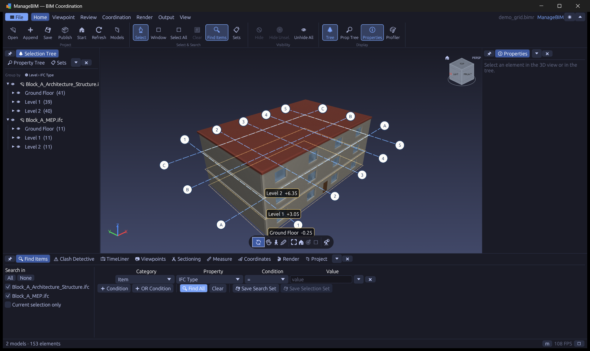
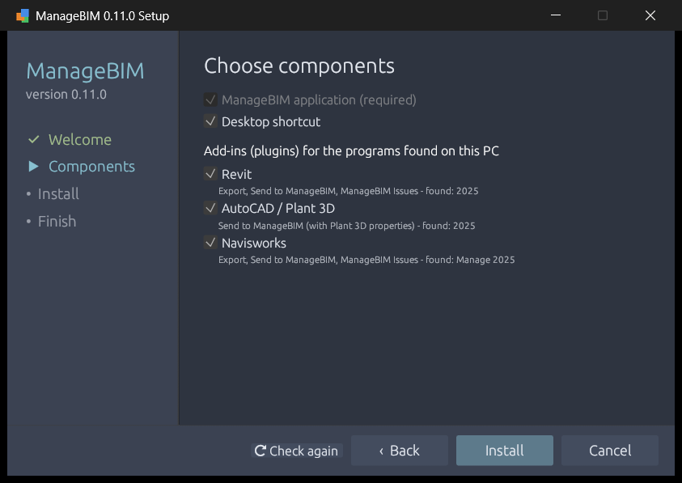
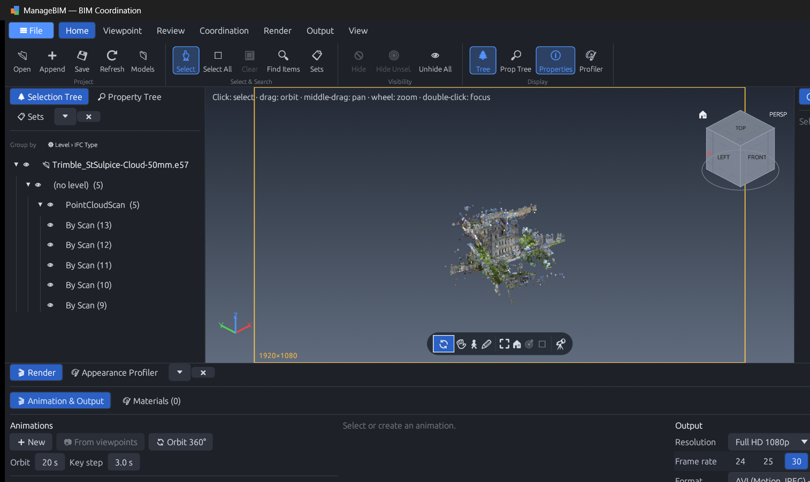

<div align="center">

# ManageBIM

**Federated BIM review and coordination for Windows - fast, light, no administrator rights needed.**

Open IFC, Revit, Navisworks, AutoCAD / Plant 3D, STEP, FBX and point clouds together, run clash detection,
manage issues and markups, and send the results back to Revit and Navisworks.

[](https://github.com/Latinu2020/ManageBIM/raw/main/download/ManageBIM-Setup-0.15.0.exe)

   



</div>

---

## Download and install

1. Download **[ManageBIM-Setup-0.15.0.exe](https://github.com/Latinu2020/ManageBIM/raw/main/download/ManageBIM-Setup-0.15.0.exe)** (about 40 MB).
2. Run it and follow the wizard: **Welcome › Components › Install › Finish**.
   - Installs for the current Windows user only - **no administrator rights needed**.
   - Pick the add-ins for the programs found on the PC (Revit, AutoCAD / Plant 3D, Navisworks).
   - Running it again upgrades or repairs an existing installation; your settings and projects are kept.
3. Start ManageBIM from the Start Menu or the Desktop shortcut.

> The installer is not digitally signed yet. If Windows SmartScreen asks, choose *More info › Run anyway*.
> Silent install: `ManageBIM-Setup-0.15.0.exe /S` (add `/NoAddins` for the application only).

<div align="center">
 &nbsp; 
</div>

---

## Features

### Model review
- **Federated models**: IFC 2x3 / IFC4 (and `.ifczip`), Revit and Navisworks (through the included add-ins), AutoCAD / Plant 3D DWG with Plant 3D properties, DXF, STEP / IGES / BREP / FCStd (OpenCascade), FBX, glTF / GLB, OBJ, STL, PLY.
- **Point clouds**: E57 and LAS, with adjustable density and point size; each scan is an item in the tree.
- **Selection Tree, Property Tree, Find Items** (search on any property), selection and search **sets**, appearance profiler, quantification with Excel export.
- **Navigation like Navisworks**: orbit, pan, walk with gravity / collision, ViewCube, walk paths, viewpoints and animations.
- **Window selection** (left → right inside, right → left crossing, like AutoCAD).

### Coordination
- **Clash Detective**: hard / clearance tests, rules, grouping (by level, grid location, item, type, proximity), status tracking between runs, HTML / CSV / BCF reports.
- **Grids and levels**: from IFC, from **DWG / DXF**, or created in the app (generator, alignment by picking points in the model). Clash locations like **"C-4 / Level 2"**. Export grids to **DXF / DWG**.
- **Sectioning**: planes and boxes, **sections by level** (level box, plan cut, only-this-level, PgUp / PgDn), filled cut faces, transparent section plane.
- **Measuring** with snapping to vertices, edge midpoints and edges; dimensions saved with viewpoints.
- **Relocate models like Navisworks**: move point to point, rotate about a picked pivot, align a face against a target face.
- **Model comparison** between versions.

### Issues and collaboration
- **Viewpoints and issues** with status, priority, assignee, comments and **markups** (line, arrow, rectangle, ellipse, cloud, text).
- **BCF 2.1 / 3.0** import and export (Revit, ACC, Solibri, BIMcollab), **Navisworks XML** viewpoints, search sets and clash tests.
- **Shared issues** through a common folder (network drive, SharePoint / OneDrive): automatic sync, deletions propagated, conflicts kept as copies.
- **Projects**: `.bimr` (like Navisworks NWF - references to the models) and **`.bimd`** (like NWD - project and all models in one file). Autosave with crash recovery.

### Output
- **IFC4 export** of all visible items or only the selection: closed solids, colours, levels, original GUIDs, all properties, reused geometry (IfcMappedItem).
- **Reference models for Revit and AutoCAD / Plant 3D** (`.mbref`) with Load / Reload / Unload.
- Images and **videos** (AVI / MP4 / GIF) with materials, lighting and ambient occlusion.

### Interface
- Ribbon in the style of Autodesk products, dark / light / **Nord** / **Tokyo Night** themes.
- Dockable panels with **auto-hide** (📌) and full-screen model view (**F11**).
- Start page with recent files (tiles or list, sort, search), like Navisworks.

<div align="center">

</div>

---

## Add-ins

| Program | Commands |
|---|---|
| **Revit 2023 – 2026** | *Export BIMC*, *Send to ManageBIM* (live update), *ManageBIM Issues* (3D view with the issue camera, section box, markups and selected elements), *ManageBIM Reference* (load / reload / unload a ManageBIM model as reference geometry) |
| **AutoCAD / Plant 3D 2021+** | `BIMCEXPORT`, `BIMCSEND`, `MBREFERENCE`, `MBREFRELOAD`, `MBREFUNLOAD` |
| **Navisworks Manage / Simulate 2022+** | *Export BIMC*, *Send to ManageBIM*, *ManageBIM Issues* (issues as Saved Viewpoints with comments, section box and redlines) |

The add-ins are installed per user by the setup (no administrator rights).

---

## System requirements

- Windows 10 or 11, 64-bit
- OpenGL 3.3 graphics (any recent integrated or dedicated GPU)
- 8 GB RAM recommended for large federated models and point clouds

---

## Building from source

Requirements: [Rust](https://rustup.rs) (stable), Visual Studio 2022 Build Tools (C++ and .NET), CMake.

```powershell
# OpenCascade runtime (STEP / IGES / BREP / ACIS solids), once
powershell -ExecutionPolicy Bypass -File tools\build-occt.ps1

# application, converters and tests
cargo build --release
cargo test --release

# add-ins (need the Autodesk API reference assemblies, restored by the scripts)
powershell -ExecutionPolicy Bypass -File revit-addin\build.ps1
powershell -ExecutionPolicy Bypass -File acad-addin\build.ps1
powershell -ExecutionPolicy Bypass -File navis-addin\build.ps1

# single-file installer + backup
powershell -ExecutionPolicy Bypass -File tools\make-backup.ps1
```

Project layout:

| Folder | Content |
|---|---|
| `src/` | application (egui / OpenGL), readers (IFC, DWG / DXF, E57, LAS, FBX…), clash, IFC export, BCF, renderer |
| `revit-addin/`, `acad-addin/`, `navis-addin/` | C# add-ins |
| `installers/` | single-file setup (wizard) and per-user install script |
| `tools/` | OpenCascade build, backup / setup packaging |
| `tests/` | integration tests (96 tests) |

File formats: [BIMC_FORMAT.md](BIMC_FORMAT.md) · changes: [CHANGELOG.md](CHANGELOG.md) · third-party components: [THIRD_PARTY.md](THIRD_PARTY.md).

---

## Third-party components

- [Open CASCADE Technology](https://dev.opencascade.org) 8.0.1 - LGPL-2.1 with the Open CASCADE exception, dynamically linked.
- [ufbx](https://github.com/ufbx/ufbx) - MIT.
- Rust crates under MIT / Apache-2.0 licences (egui, glam, rayon, acadrust, rusqlite…).

Autodesk, Revit, Navisworks, AutoCAD and Plant 3D are trademarks of Autodesk, Inc. ManageBIM is an independent project and is not affiliated with Autodesk.
