<div align="center">


# ManageBIM

**Federated BIM review, coordination and presentation for Windows, Linux and FreeBSD.**

Open IFC, Revit, Navisworks, AutoCAD / Plant 3D, STEP, point clouds and open city formats together; run clash detection and model checks;<br>
produce 2D drawings, reports and path-traced renders — and stay in sync with Revit and Navisworks.

[](https://github.com/Latinu2020/ManageBIM/releases/latest)
&nbsp;
[](https://github.com/Latinu2020/ManageBIM/releases)

[](https://github.com/Latinu2020/ManageBIM/actions/workflows/build.yml)


</div>

---

## Contents

- [Overview](#overview)
- [Download and install](#download-and-install)
- [What's new in 0.29](#whats-new-in-029)
- [Features](#features)
- [Supported formats](#supported-formats)
- [Gallery](#gallery)
- [Add-ins for Autodesk products](#add-ins-for-autodesk-products)
- [AI connection (MCP)](#ai-connection-mcp)
- [System requirements](#system-requirements)
- [Building from source](#building-from-source)
- [Project status and support](#project-status-and-support)
- [License](#license)

---

## Overview

ManageBIM is a native desktop application for reviewing and coordinating federated building models. It follows the workflow of Navisworks — Selection Tree, Find Items, Clash Detective, TimeLiner, viewpoints — and adds drawing production, open-standard data exchange and physically based rendering, in a single program that installs without administrator rights.

| | |
|---|---|
| **Fast and light** | Native Rust and OpenGL. Large federated models open in seconds; adaptive level of detail keeps navigation fluid. |
| **Connected to your tools** | Add-ins for Revit, Navisworks and AutoCAD / Plant 3D send models, bring issues back, sync the selection live and load ManageBIM models as references. |
| **Coordination, not only viewing** | Clash detection with rules and severity, clearance zones, automatic provisions for void, model checking against buildingSMART IDS. |
| **Drawings and presentation** | 2D views with visible and hidden lines (PDF / DWG), sheets with title blocks, GPU path tracing with scanned PBR materials. |
| **Open standards** | IFC 2x3 / IFC4 (MVD), BCF 2.1 / 3.0, IDS 1.0, bSDD, CityJSON, 3D Tiles, USD, 3MF, E57 / LAS / LAZ, glTF, MaterialX. |
| **Free and open source** | MIT licence. No account and no subscription. |

<table>
<tr>
<td width="50%">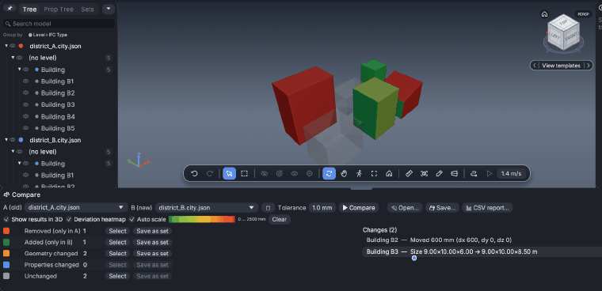<br><sub><b>Revision comparison</b> — every surface is measured against the previous version and painted with a deviation heatmap.</sub></td>
<td width="50%">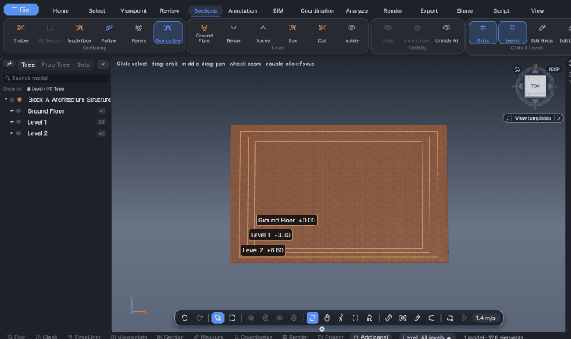<br><sub><b>Multi-view drawing</b> — all faces of the section box on one sheet, with live preview and export to PDF or DWG at 1:1.</sub></td>
</tr>
<tr>
<td width="50%">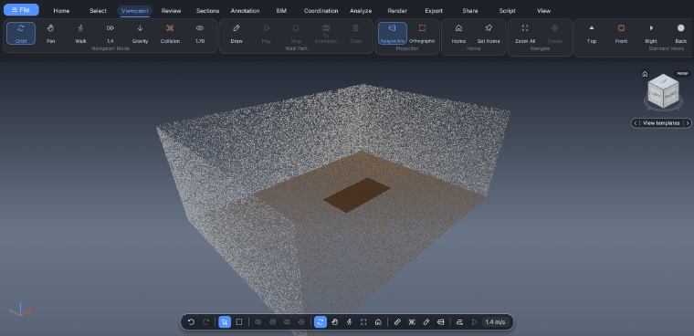<br><sub><b>Walk paths on scans</b> — points snap onto the point cloud; segment lengths, directions and a live preview.</sub></td>
<td width="50%">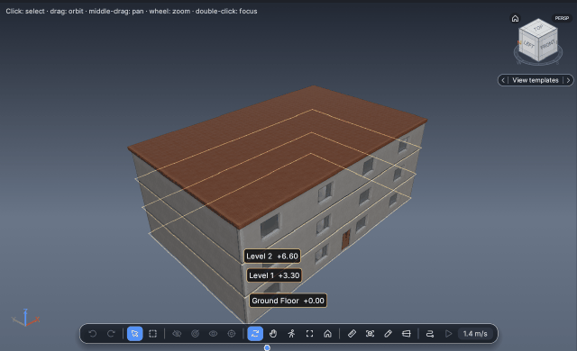<br><sub><b>ViewCube</b> — 26 directions with a compass ring and arrows to the neighbouring faces.</sub></td>
</tr>
</table>

---

## Download and install

| Platform | Package | Notes |
|---|---|---|
| **Windows 10 / 11** (x64) | [ManageBIM-Setup-0.29.x.exe](https://github.com/Latinu2020/ManageBIM/releases/latest) | Setup wizard with the Revit, Navisworks and AutoCAD / Plant 3D add-ins, the OpenCascade runtime, Intel Open Image Denoise, a software OpenGL fallback and the scanned PBR material library. Per-user install, no administrator rights. |
| **Linux** (x86-64) | [ManageBIM-0.29.x-x86_64.AppImage](https://github.com/Latinu2020/ManageBIM/releases/latest) | Single file: `chmod +x` and run. |
| **FreeBSD** (x86-64) | [ManageBIM-0.29.x-freebsd-x86_64.tar.gz](https://github.com/Latinu2020/ManageBIM/releases/latest) | Unpack and run `./ManageBIM`; requires `pkg install mesa-libs libxkbcommon`. |

**Windows notes**

- The installer is not yet code-signed. If SmartScreen appears, choose *More info › Run anyway*.
- Silent install: `ManageBIM-Setup-<version>.exe /S` — add `/NoAddins` to install the application only.
- Installing over an older version replaces the application and the add-ins and keeps your settings.

**Linux / FreeBSD notes** — the Autodesk add-ins and the native STEP / IGES reader are Windows-only; everything else is identical.

**First steps** — open **Help › Demo** for a sample project (architecture, structure, MEP and a 4D schedule), press **Ctrl+K** for the command palette, or read **Help › Manual**.

---

## What's new in 0.29

**0.29.5** (local build, not published)
- **Headless model checks for CI**: `ManageBIM --check model.ifc [more] [--ids spec.ids] [--out report.json]` runs the quick checks and the IDS rules without a window or a graphics card; the JSON report contains every failure and the process exits 0 (pass), 1 (failures) or 2 (load / IDS error).
- **5D cost**: load a price catalog from Excel / CSV (code, description, unit, unit price, optional budget), price the quantities, compare budget with actual, and export the result to Excel or CSV. The catalog and the chosen quantity column are saved in the project.
- **MCP for testing**: new tools `get_performance`, `set_performance`, `run_check`, `get_log`, `load_price_catalog`, `get_cost` and `export_cost` - an assistant can now measure what was drawn, run the checks, read the errors and verify 5D numbers through the same connection used for `capture_view`.
- **Performance measurement (C1)**: `get_performance` reports FPS, elements / triangles total vs. drawn, hidden and frustum / section / LOD culled counts, draw calls and point-cloud points; the viewport already culls by frustum and uses adaptive LOD.
- **Notifications and exit**: toasts wrap on several lines instead of one, and closing the window (X, Alt+F4 or File › Exit) asks for confirmation, with save-and-close / close-without-saving / cancel.
- **Code quality / CI**: clippy baseline lowered from 33 to 0 (`as_chunks`, Rust 1.88+), `quality.sh` accepts a zero-warning baseline, and the FreeBSD memory test no longer assumes `/proc/meminfo` exists.

**0.29.2**
- **Interactive Ray Trace fixes**: no black rectangle at startup, no flicker between half and full resolution, and the path-traced image stays on screen while it refines instead of switching back to the raster view between samples.
- **Stability**: damaged HDR headers can no longer request gigabytes or panic the RLE decoder, damaged LAZ headers are capped, OpenGL resources are freed on failed allocations, and incomplete render targets are never reused.
- **Functional fixes**: lights placed in 3D land on the surface with a real face normal, OSNAP *Surface* respects its checkbox, viewpoint **Update**/**Go to** keep the same state and selection, cable trays and Romanian pipes are classified correctly, IFC angle properties are exported in radians, and MCP `run_script` no longer runs each script twice.
- **Verification**: MCP tools `get_render_status` and `capture_view(live: true)`, plus `tools\test-raytrace.ps1`, `tools\verify-release.ps1` and fuzz targets for HDR / BIMC / LAS.

**0.29.1**
- **Multi-bounce indirect light** in renders and the Ray Trace view (CPU and GPU): sun and lamp light bounces up to four times between surfaces, so interiors are brighter and corners are no longer dark. Adjustable in the Path Trace window.
- **Faster Ray Trace refinement** on fast graphics cards — up to 64 samples per frame within the frame budget.
- **Stability**: damaged LAS point clouds, out-of-memory on the graphics card and missing data in quantities, 4D and reports no longer close the application; robustness testing extended to over 6,500 damaged files.
- **AI connection**: new `render_settings` tool for Ray Trace, light bounces, brightness and sun.
- Code quality: clippy warnings reduced from 130 to 33, the 3D view and application state restructured.

**0.29.0**
- **Path tracing on the graphics card** and an **interactive Ray Trace view** that refines while the camera stands still, with an edge-aware filter while moving and Intel Open Image Denoise when converged.
- **All length units** including feet-inches; **OSNAP** up to 40 px with a visible capture zone.
- **Level & Storey Manager**, a **detailed Dashboard report** with clash and viewpoint sheets, IFC Mapping in its own window.
- **Add-ins that never close the host program**, tested automatically; damaged files of every supported format are handled without crashing.
- **Nothing else to install on Windows** — the C runtime and a software OpenGL fallback (Mesa) are included.

Full history: [CHANGELOG](CHANGELOG.md) · Planned work: [ROADMAP](ROADMAP.md)

---

## Features

<details open>
<summary><b>Model review</b></summary>

- **Federated models** from IFC, Revit and Navisworks (through the add-ins), AutoCAD / Plant 3D, STEP, glTF, point clouds and open city formats — see [Supported formats](#supported-formats).
- **Selection Tree** grouped by any property, **Property Tree**, **Find Items** with conditions, selection and search **sets**, **Smart sets** with live value counts and plain-language search, **Select Same Type / Category**.
- **Navigation** like Navisworks: orbit, pan, walk with gravity and collision, ViewCube, viewpoints, walk paths and animations; adaptive level of detail on large models.
- **Visual styles**: Realistic, Shaded, Concept, Wireframe and Hidden line; sun shadows by date, time and location.
- **Point clouds**: one item per scan, LAS split by classification with intensity, returns and GPS time; colour by elevation; measurements snap to scan points.
- **Command palette** (Ctrl+K), dockable and floating panels, five themes, interface in **English or Romanian**.
- **Undo / Redo** for the view and for model changes (properties, colours, materials).
</details>

<details open>
<summary><b>Coordination</b></summary>

- **Clash Detective** — hard and clearance tests with severity, discipline templates and smart rules (normal connections ignored, responsible discipline assigned, grouping by system, level, grid location, type or assignee); New / Active / Reviewed / Approved / Resolved workflow with audit trail; **Update All** with a change summary; **SwitchBack** to Revit and Navisworks; clash matrix; import and export of tests as Navisworks XML or CSV; HTML, CSV, Excel, BCF and Navisworks reports.
- **Model Checker** — rule sets or **buildingSMART IDS 1.0** (import and export) covering properties, attributes, classifications and materials, with Excel and BCF reports; quick checks without IDS (missing level, name, classification, material or geometry; duplicate GUIDs).
- **Coordination objects** — clearance zones, **automatic provisions for void** where ducts, pipes and cable trays cross walls and slabs, and placeholder volumes; part of clash detection and of the IFC export.
- **Classification and bSDD** — search the buildingSMART Data Dictionary online or a local Uniclass / OmniClass catalogue and assign codes, exported as `IfcClassificationReference`.
- **Grids and levels** from IFC, DWG / DXF or created in the application; **Level & Storey Manager**; levels sent to Plant 3D / AutoCAD and Navisworks.
- **Live Link** — the selection follows Revit and Navisworks in both directions.
- **As-built check** — the model against the point cloud: built, partial, missing, not scanned.
- **Compare** model revisions by geometry (per-triangle deviation heatmap) and parameter by parameter.
- **TimeLiner 4D** from CSV, MS Project or Primavera P6 XML, with videos showing date and legend; **quantity take-off**; **colour by parameter**.
- **User data** like Navisworks — custom tabs and properties on any element, import from Excel / CSV.
</details>

<details open>
<summary><b>Drawings, rendering and output</b></summary>

- **Sections** — section boxes with stretch handles, planes, sections by level, filled and hatched cuts.
- **2D drawings** — pick a face of the section box for an Inventor-style view: cut outline, visible edges and dashed hidden lines with technical line weights; complete plans with hatching, element tags, grid bubbles and dimension chains; multi-view sheets.
- **DWG / DXF / PDF** — model space or A3 – A0 sheets at standard scales with an editable title block, written directly in AutoCAD 2018 format.
- **Rendering** — GPU path tracing (CPU fallback) with soft sun shadows, sky and HDRI light, lamps, GGX reflections, clearcoat, sheen, glass and multi-bounce indirect light, denoised with Intel Open Image Denoise; interactive Ray Trace view.
- **Materials** — 28 scanned PBR materials (ambientCG, CC0) applied by IFC type; import of PBR packs and **OpenPBR / MaterialX**.
- **Lighting** — point, spot and distant lights with a move / rotate gizmo; sun and sky by date, time and location; night mode.
- **Images and video** — PNG, path-traced images, MP4, AVI, GIF and PNG frames, optionally rendered with materials.
- **Reports** — project **Dashboard** exported to PDF or Word with a sheet and picture for every open clash and every viewpoint.
- **Web viewer** — the model in a single offline `.html` file with tree, search, properties, section and measurement.
</details>

<details open>
<summary><b>Issues and collaboration</b></summary>

- **Viewpoints and issues** with status, priority, assignee, comments, markups and folders.
- **BCF 2.1 / 3.0** import and export (Revit, ACC, Solibri, BIMcollab); Navisworks XML viewpoints, search sets and clash tests.
- **Shared issues** through a common folder (network drive, SharePoint / OneDrive) with automatic synchronisation.
- **Projects** — `.bimr` (references, like NWF) and `.bimd` (single file, like NWD); autosave and crash recovery.
</details>

---

## Supported formats

| Format | Import | Export | Notes |
|---|:---:|:---:|---|
| IFC 2x3 / IFC4 (`.ifc`, `.ifczip`, ifcXML, ifcJSON) | ● | ● | Openings, systems, classifications, georeference; export with MVD selection |
| Revit / Navisworks | ● | | Through the add-ins (`.bimc`); `.nwd` / `.nwc` / `.nwf` through Navisworks |
| DWG / DXF (AutoCAD, Plant 3D) | ● | ● | Plant 3D properties, block attributes, XDATA; 2D drawings and sheets on export |
| STEP / IGES / BREP / FCStd | ● | | OpenCascade runtime (Windows) |
| glTF / GLB | ● | ● | `EXT_structural_metadata` |
| FBX, OBJ, STL, PLY | ● | | |
| CityJSON / CityJSONSeq, 3D Tiles 1.0 / 1.1 | ● | | Attributes, LoD, semantic surfaces, batch tables |
| USD (`.usda`), 3MF | ● | | |
| E57, LAS, LAZ | ● | | Per-scan items, classification, intensity, GPS time |
| BCF 2.1 / 3.0 | ● | ● | Issues, viewpoints, markups |
| buildingSMART IDS 1.0 | ● | ● | Model Checker rules |
| MaterialX / OpenPBR | ● | ● | Material parameters and texture paths |
| Navisworks XML | ● | ● | Clash tests, selection and search sets, viewpoints |
| PDF, Word, Excel, CSV, HTML | | ● | Sheets, reports, schedules, web viewer |
| MP4, AVI, GIF, PNG | | ● | Images, animations, 4D videos |

---

## Gallery

<table>
<tr>
<td width="50%">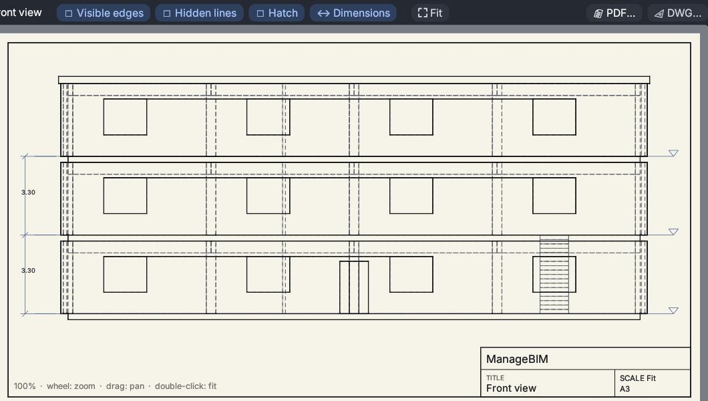<br><sub><b>2D drawing</b> — the view from a face of the section box, with levels and dimensions on a sheet.</sub></td>
<td width="50%"><br><sub><b>Clash Detective</b> — tests, statuses and the clashing elements with their properties.</sub></td>
</tr>
<tr>
<td width="50%">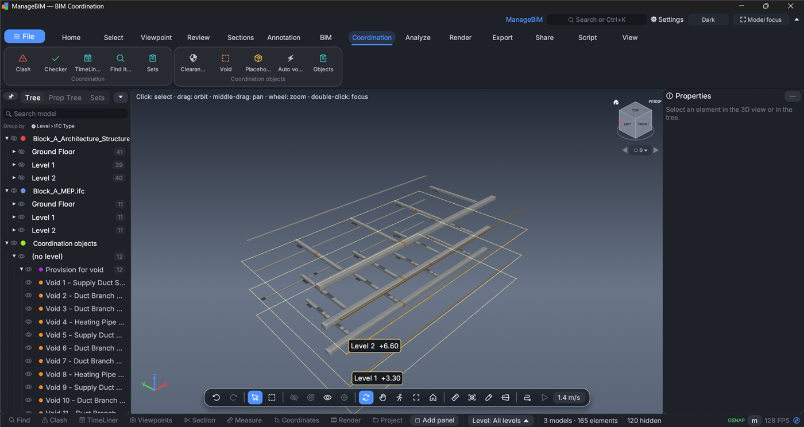<br><sub><b>Coordination objects</b> — automatic provisions for void, clearance zones and placeholder volumes.</sub></td>
<td width="50%">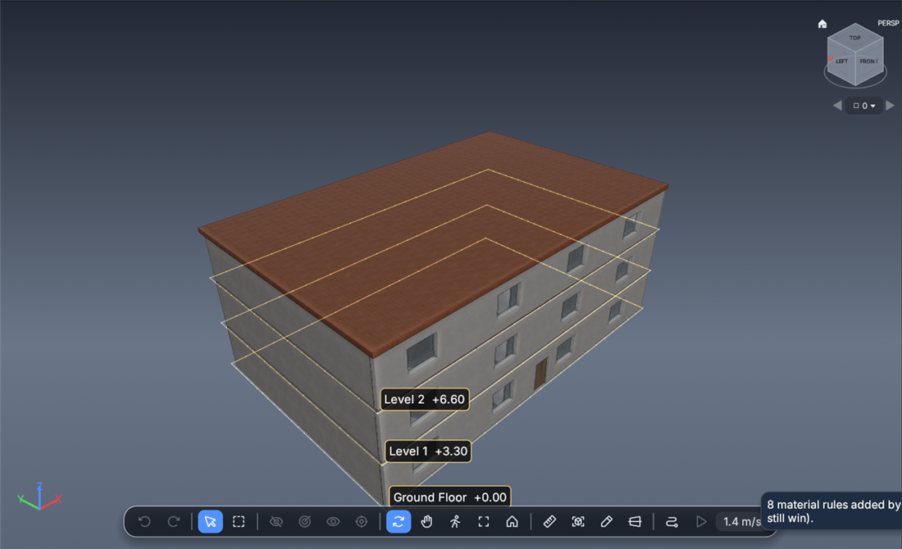<br><sub><b>PBR materials</b> — 28 scanned materials applied by IFC type.</sub></td>
</tr>
</table>

<details>
<summary><b>More screenshots</b></summary>

<table>
<tr>
<td width="50%">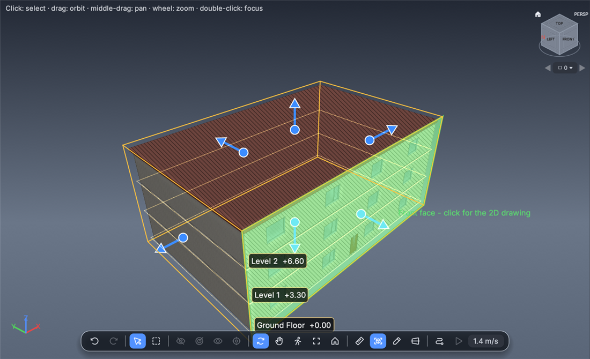<br><sub><b>Pick face</b> — choose the drawing view directly on the section box.</sub></td>
<td width="50%">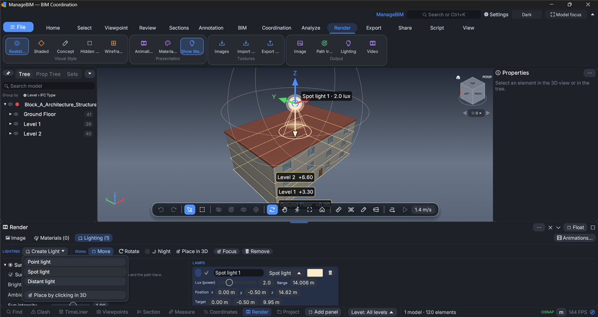<br><sub><b>Lighting</b> — point, spot and distant lights, sun and sky.</sub></td>
</tr>
<tr>
<td width="50%"><br><sub><b>Update All</b> — new, active and resolved clashes per test.</sub></td>
<td width="50%"><br><sub><b>Clash matrix</b> — selections against selections, statuses per cell, Excel export.</sub></td>
</tr>
<tr>
<td width="50%">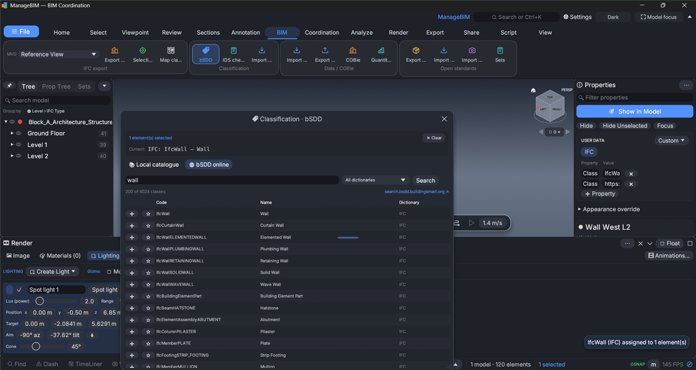<br><sub><b>bSDD classification</b> — search the buildingSMART Data Dictionary and assign codes.</sub></td>
<td width="50%"><br><sub><b>Animations and 4D</b> — record, orbit, walk paths and TimeLiner sequences, exported as video.</sub></td>
</tr>
<tr>
<td width="50%"><br><sub><b>2D plans</b> — hatched cuts, tags, grid bubbles and dimension chains on a sheet.</sub></td>
<td width="50%">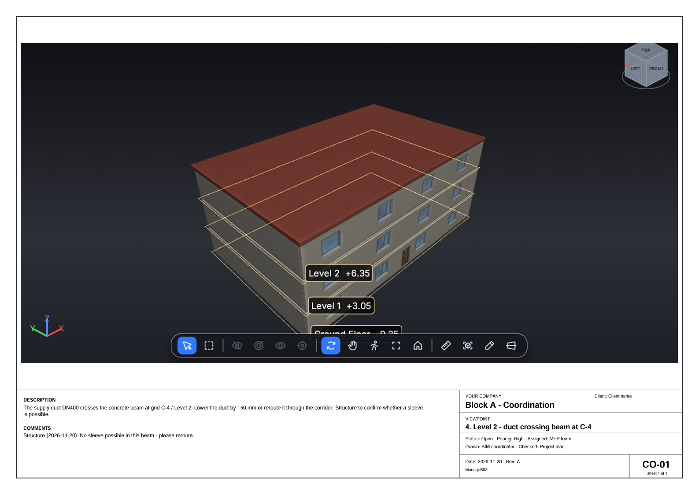<br><sub><b>PDF sheets</b> from viewpoints, A3 to A0, with title block.</sub></td>
</tr>
<tr>
<td width="50%"><br><sub><b>Point clouds</b> next to the model, with the as-built check.</sub></td>
<td width="50%"><br><sub><b>Web viewer</b> — a single offline HTML file.</sub></td>
</tr>
<tr>
<td width="50%">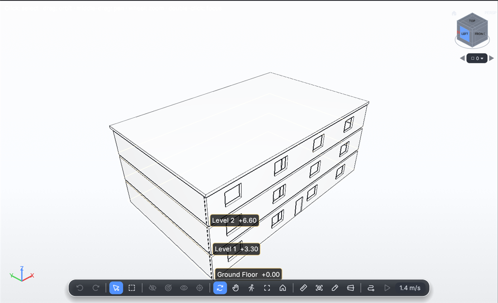<br><sub><b>Hidden line</b> visual style.</sub></td>
<td width="50%">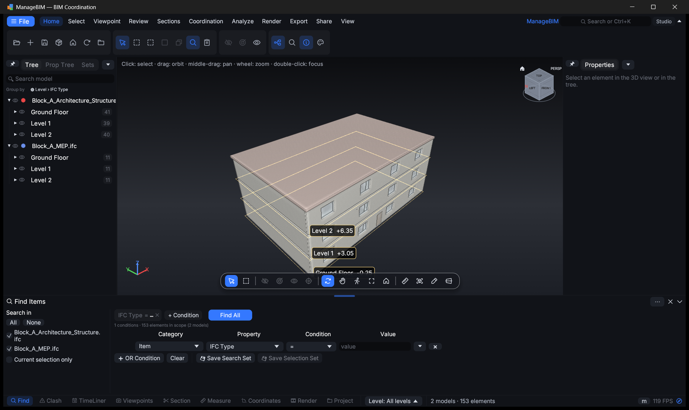<br><sub><b>Concept</b> visual style.</sub></td>
</tr>
<tr>
<td width="50%"><br><sub><b>Themes</b> — Studio, Dark, Light, Tokyo Night, Nord.</sub></td>
<td width="50%">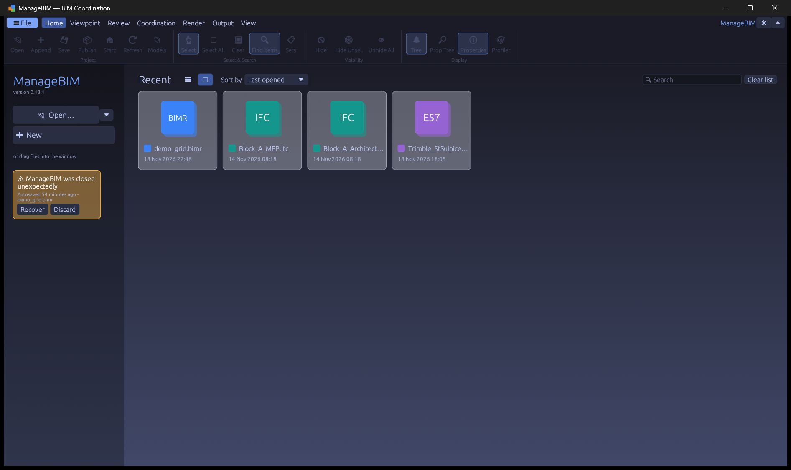<br><sub><b>Start page</b> with recent projects, demo and manual.</sub></td>
</tr>
<tr>
<td width="50%"><br><sub><b>Setup wizard</b> — per user, add-ins detected automatically.</sub></td>
<td width="50%"><br><sub><b>English / Română</b> interface.</sub></td>
</tr>
</table>
</details>

---

## Add-ins for Autodesk products

| Program | Versions | Commands |
|---|---|---|
| **Revit** | 2023 – 2026 | *Export BIMC*, *Send to ManageBIM* (live update), *ManageBIM Issues*, *ManageBIM Reference*, *Sync Selection* |
| **Navisworks Manage / Simulate** | 2022 – 2026 | *Export BIMC*, *Send to ManageBIM*, *ManageBIM Issues*, *ManageBIM Levels*, *Walk path*, *Sync Selection* |
| **AutoCAD / Plant 3D** | 2021 and later | `BIMCEXPORT`, `BIMCSEND`, `MBLEVELS`, `MBREFERENCE`, `MBREFRELOAD`, `MBREFUNLOAD` |

The add-ins are installed per user by the setup wizard. Every command runs inside an error guard: an unexpected error is logged to `%LOCALAPPDATA%\ManageBIM\addin.log` and shown in ManageBIM, and never closes the host program.

---

## AI connection (MCP)

ManageBIM includes a local [Model Context Protocol](https://modelcontextprotocol.io) server (**Share › AI connection**). Assistants such as Claude Code, Claude Desktop, OpenCode, VS Code or local Ollama models can find elements, read properties, select, hide and isolate, set properties, run clash tests and scripts, change the render settings and capture the 3D view.

- Off by default; listens on `127.0.0.1` only and requires a bearer token.
- Ready-to-copy client configurations in the AI connection window; `ManageBIM.exe --mcp-stdio` bridges clients that use stdio.
- A read-only mode blocks every tool that changes the model.
- `get_render_status` reports Ray Trace samples, resolution, denoise state and GPU errors; `capture_view(live: true)` returns the accumulated 3D view instead of a new offscreen render.

---

## System requirements

- **Operating system**: Windows 10 / 11 64-bit, Linux x86-64 (X11 or Wayland) or FreeBSD 14 x86-64.
- **Graphics**: OpenGL 3.3. On Windows, systems without it (virtual machines, older Remote Desktop) fall back automatically to the included software OpenGL.
- **Memory**: 8 GB RAM recommended for large federated models and point clouds.
- **Windows dependencies**: none — no Visual C++ Redistributable, no .NET, no administrator rights. The add-ins use the .NET runtime of the host program.

---

## Building from source

Requirements: [Rust](https://rustup.rs) (stable). On Windows also Visual Studio 2022 Build Tools (C++ and .NET) and CMake.

```bash
git clone https://github.com/Latinu2020/ManageBIM.git
cd ManageBIM
cargo build --release        # the application and bimc-convert
cargo test --release         # the test suite
```

The repository is self-contained. OpenCascade (STEP / IGES / BREP) and the Autodesk add-ins are optional; without them the application builds and runs, and those formats report that the runtime is missing. On Windows, `powershell -ExecutionPolicy Bypass -File tools\verify-release.ps1` runs the tests, the clippy/rustfmt gate, the release build with add-ins, the setup wizard, a Ray Trace smoke test through MCP and a SHA256 manifest. `tools\test-raytrace.ps1` can be used on its own; `tools\fuzz.ps1` needs nightly + cargo-fuzz.

<details>
<summary><b>Windows: add-ins, OpenCascade and the installer</b></summary>

```powershell
# OpenCascade runtime (STEP / IGES / BREP / ACIS solids), once
powershell -ExecutionPolicy Bypass -File tools\build-occt.ps1

# add-ins (the Autodesk API reference assemblies are restored by the scripts)
powershell -ExecutionPolicy Bypass -File revit-addin\build.ps1
powershell -ExecutionPolicy Bypass -File acad-addin\build.ps1
powershell -ExecutionPolicy Bypass -File navis-addin\build.ps1

# application and add-in installers
cargo build --release --features addins

# PBR material library, denoiser and software OpenGL, once
cargo run --release --bin fetch_pro_library
powershell -ExecutionPolicy Bypass -File tools\get-oidn.ps1
powershell -ExecutionPolicy Bypass -File tools\get-mesa.ps1

# setup wizard -> ManageBIM-Setup-<version>.exe
powershell -ExecutionPolicy Bypass -File tools\make-setup.ps1

# automated add-in test (AutoCAD / Plant 3D, Navisworks, Revit)
powershell -ExecutionPolicy Bypass -File tools\test-addins.ps1
```
</details>

<details>
<summary><b>Linux and FreeBSD packages</b></summary>

```bash
# Debian / Ubuntu build dependencies
sudo apt install pkg-config libx11-dev libxcursor-dev libxrandr-dev libxi-dev libxkbcommon-dev libwayland-dev libgl1-mesa-dev
cargo build --release --bin ManageBIM
bash packaging/linux/build-appimage.sh      # -> dist/ManageBIM-<version>-x86_64.AppImage

# FreeBSD
pkg install rust pkgconf libxkbcommon wayland mesa-libs
cargo build --release --bin ManageBIM
sh packaging/freebsd/build-tarball.sh       # -> dist/ManageBIM-<version>-freebsd-x86_64.tar.gz
```
</details>

<details>
<summary><b>Cross-compiling the Windows application from Linux</b></summary>

```bash
rustup target add x86_64-pc-windows-gnu
sudo apt install gcc-mingw-w64-x86-64 g++-mingw-w64-x86-64
cargo build --release --target x86_64-pc-windows-gnu --bin ManageBIM --bin bimc-convert
```
</details>

**Continuous integration** — every push is built and tested on Windows, Linux and FreeBSD with [GitHub Actions](.github/workflows/build.yml), together with clippy and licence checks. A `v*` tag publishes the Windows setup, the Linux AppImage and the FreeBSD package to [Releases](https://github.com/Latinu2020/ManageBIM/releases).

| Folder | Content |
|---|---|
| `src/` | Application (egui / OpenGL), file readers, clash detection, model checker, renderer and path tracer, exporters |
| `src/bin/` | `bimc-convert` command-line converter and build tools |
| `revit-addin/`, `acad-addin/`, `navis-addin/` | C# add-ins |
| `installers/`, `packaging/` | Windows setup wizard; Linux AppImage and FreeBSD packaging |
| `tests/` | Integration, robustness and endurance tests |
| `tools/` | Build, packaging and add-in test scripts |

Further documentation: [BIMC file format](BIMC_FORMAT.md) · [Changelog](CHANGELOG.md) · [Roadmap](ROADMAP.md) · [Third-party components](THIRD_PARTY.md)

---

## Project status and support

ManageBIM is under active development; releases follow [the changelog](CHANGELOG.md). Bug reports and feature requests are welcome in [GitHub Issues](https://github.com/Latinu2020/ManageBIM/issues) — please include the ManageBIM version (**Help › About**), the operating system and, for crashes, `crash.log` from `%APPDATA%\ManageBIM` (Windows).

---

## License

ManageBIM is released under the [MIT License](LICENSE). Third-party components keep their own licences — Open CASCADE (LGPL-2.1, dynamically linked), Intel Open Image Denoise (Apache-2.0), Mesa (MIT), ufbx (MIT), Inter (SIL OFL 1.1), Phosphor icons (MIT) and Rust crates under MIT / Apache-2.0; see [THIRD_PARTY.md](THIRD_PARTY.md).

<sub>Autodesk, Revit, Navisworks, AutoCAD and Plant 3D are trademarks of Autodesk, Inc. ManageBIM is an independent project and is not affiliated with or endorsed by Autodesk.</sub>
